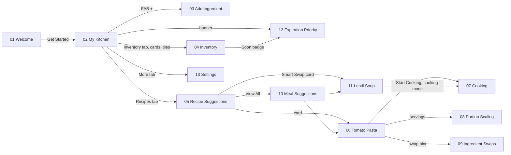

# FoodSafe — pixel-measured design specification (master)

Source of truth: `reference/mockup/board-original.png` (1536 × 1024 px), a board of 13 hand-tilted phone screens drawn in a hand-painted "paper and watercolour" style. This package turns that board into something an AI agent can build from:

| What | Where |
|---|---|
| This master spec (tokens, type, colour, components, assets, behaviour, iOS mapping, QA) | `design/design.md` |
| One spec per screen (every text, shape, asset, paint order, measured fidelity) | `design/screens/NN-name.design.md` (13 files, index in §8) |
| Machine-readable tokens | `design/tokens.json`, `design/DesignTokens.swift` |
| Exact assets (PNG @1x/2x/3x with alpha, SVG for web glyphs, fonts) | `assets/NN-name/`, `design/fonts/` |
| HTML reference replica of every screen (renders at 393 pt wide, 1 CSS px = 1 pt) | `replica/screens/NN-name/index.html`, `renders/NN-name.png` |
| Diff evidence (side-by-side, edges, per-region scores) | `diff/NN_side.jpg`, `diff/NN_edges.jpg`, `diff/NN_metrics.json` |
| Tools that measured and rebuilt everything | `tools/` (`tools/README.md` is the worker manual) |
| Audit of the other AI's package | `reports/OTHER-AI-AUDIT.md` |

## 0. How to use this package (for the agent that builds the app)

1. Read §1–§7 once. Then, for each screen you build, read its `design/screens/NN-name.design.md` and place every element at the stated coordinates (pt, origin top-left, canvas 393 pt wide).
2. Take colours, type roles and radii from `design/tokens.json` / `DesignTokens.swift`. Where a per-screen value differs from a token, the per-screen value is the measurement and the token is the cross-screen median (see "Two build modes" below).
3. Use the supplied art. Never redraw or substitute the food illustrations, the wordmark, the category art or the doodles: they are cut from the mockup (§7).
4. Behaviour that the mockup does not show (navigation targets, validation, empty states, etc.) is marked **inferred** in §9 and in each screen file. Implement it, but do not treat it as specification.
5. Verify every screen with the procedure in §11 before calling it done.

**Two build modes.** *Pixel-faithful*: use each screen's own coordinates, sizes and colours exactly (the mockup is not grid-consistent, see §6). *Normalised*: snap to the token medians of §3–§6 so the app behaves like a design system. Choose one per project; do not mix inside one screen.

## 1. Method and accuracy (what "pixel-perfect" means here)

- The board is a single PNG. Each phone outline was perspective-rectified to its own canvas, **393 pt wide** (iPhone 15/16 width). 1 pt = 1 CSS px in the HTML replica. Native resolution is only ≈ 0.44–0.58 px per pt, so every measurement is good to **±1–2 pt**; sizes come from ink heights, positions from edge profiles at 4 px/pt, colours from the darkest ink core or the interior ring of a fill.
- Nothing is estimated by eye. Per element the pipeline measured: text ink box → font size, tracking, baseline, tilt, colour; box edges → x, y, w, h, corner radius, fill, border (stroke width fixed at 1.2 pt because thinner strokes cannot be resolved), halo; circles by ellipse fit; hairlines by cross-profile peak and energy-conserving colour.
- Every screen was rendered in Chromium at DPR 2 and diffed against the mockup at native resolution (SSIM, edge-map NCC, MAE, mean-colour Lab distance, per-region worst list). Scores are in §11. They are limited by the fonts (the lettering is AI-drawn, no font matches it) and by the paper grain, not by layout error.
- The replica deliberately omits the board decoration: phone bezel and rounded corners, sticky notes, tape, the tilt of the welcome card, paper grain and stains, brush hatching outside the card art.

## 2. Canvas, device mapping, safe areas

| screen | title | canvas pt (w × h) | native px of the mockup crop | px per pt |
|---|---|---|---|---|
| 01 | Welcome | 393 × 861.2 | 222 × 487 | 0.56 |
| 02 | My Kitchen | 393 × 845.4 | 229 × 492 | 0.58 |
| 03 | Add Ingredient | 393 × 810.5 | 237 × 488 | 0.60 |
| 04 | Inventory | 393 × 868.4 | 225 × 497 | 0.57 |
| 05 | Recipe Suggestions | 393 × 781.6 | 228 × 453 | 0.58 |
| 06 | Tomato Pasta | 393 × 769.1 | 230 × 449 | 0.59 |
| 07 | Cooking... | 393 × 697.9 | 210 × 372 | 0.53 |
| 08 | Portion Scaling | 393 × 737.0 | 193 × 362 | 0.49 |
| 09 | Ingredient Swaps | 393 × 734.4 | 194 × 363 | 0.49 |
| 10 | Meal Suggestions | 393 × 700.1 | 210 × 374 | 0.53 |
| 11 | Lentil Soup | 393 × 775.1 | 187 × 369 | 0.48 |
| 12 | Expiration Priority | 393 × 795.0 | 174 × 351 | 0.44 |
| 13 | Settings | 393 × 668.6 | 188 × 319 | 0.48 |

- Heights differ because each outline was cropped by the original artist; the width is common. Treat the canvas as a **393 × 852 reference** (iPhone 15/16): anchor the status/nav area to the top safe area, anchor tab bar and bottom buttons to the bottom safe area, let the middle scroll if content is taller than the device.
- The status bar in the mockup is drawn (time "9:41", signal, Wi-Fi, battery). In a real app use the system status bar; the drawn one is only a placement reference (§6).
- On other devices scale horizontally with the width (safe-area-aware margins), do not scale type; the type roles are in pt.
- The screens have no home-indicator art. Respect the bottom safe area.

## 3. Typography

### 3.1 Decision
The mockup lettering is AI-drawn handwriting; **no installable font matches it exactly**. 338 candidate font files were rendered against the mockup lettering of screen 02 at native pixels (`reports/fontrank_pool_02.json`) and scored on four metrics: edge-map NCC, SSIM, the tracking needed to fit the measured widths, and the size spread across roles. **Patrick Hand 400** (SIL OFL 1.1) has the best combined rank (sum of the four ranks 54; runner-up Bubblegum Sans 94): edge-NCC 0.573 (#3), SSIM 0.424 (#6), tracking 0.039 em (#11), size spread 0.044 (#34). It is the global face. It is **not** best on every metric: Annie Use Your Telescope has the best edge-NCC alone (0.610) but ranks #179 combined (more tracking, larger size spread). Screen 01 uses **Annie Use Your Telescope 400** (SIL OFL 1.1) for the slogan and the button label because its thin slanted pen strokes looked closer to that lettering on a visual contact sheet; this is a visual judgement, not a measured ranking on screen 01. The other AI's package uses Purisa 400, which ranks #69 combined of 338 (edge-NCC #33, SSIM #150, tracking #86, size spread #192): clearly behind Patrick Hand on this test, but not the worst.

| face | file (bundle this) | PostScript name | licence / copyright | metrics (units/em) | used for |
|---|---|---|---|---|---|
| Patrick Hand 400 | `design/fonts/PatrickHand-Regular.ttf` | `PatrickHand-Regular` | SIL OFL 1.1 — Copyright (c) 2012 Patrick Wagesreiter (mail@patrickwagesreiter.at) (`design/fonts/OFL-PatrickHand.txt`) | upm 1000, cap 661, x 467 | all text on screens 02–13 and the tagline / "Sign In" on 01 |
| Annie Use Your Telescope 400 | `design/fonts/AnnieUseYourTelescope-Regular.ttf` | `AnnieUseYourTelescope-Regular` | SIL OFL 1.1 — Copyright (c) 2010, Kimberly Geswein (kimberlygeswein.com) (`design/fonts/OFL-AnnieUseYourTelescope.txt`) | upm 1024, cap 730, x 427 | slogan (3 lines) and "Get Started" label on screen 01 only |

### 3.2 Rendering rules (apply to every text)
- **Position**: the per-screen table gives the first-glyph origin x and the **baseline y** (pt). Place the text so the baseline sits there; do not centre it in a line box.
- **Size**: measured from the ink height of the run; sizes of one role on one screen are snapped to that screen's role median when within 22 %. The role table in §3.3 is the cross-screen median with the min–max range.
- **Tracking**: fitted to the measured ink width and clamped to −0.06 … +0.16 em. Values are in em in the table below and in pt in the per-screen files.
- **Faux bold**: the mockup ink is 1.2–1.4× heavier than Patrick Hand regular. Every text except page titles, hero titles and the welcome tagline gets a **0.3 pt outline stroke in the text colour** (`-webkit-text-stroke: 0.3px`).
- **Condense**: where the mockup letters are narrower than the font at the measured height (banner line and Tips lines on 12) a horizontal scale `sx` is applied (0.78–0.91) with the origin at the first glyph baseline. Listed in the per-screen note column.
- **Tilt**: the welcome screen has tilted lines (tagline −6.5°/−6.75°, slogan −8.5°/−10°/−11.25°, button label −2.5°); a few other lines carry ≤ 2.5° measured tilt. Rotation is about the first glyph at the baseline.
- **Colour**: the darkest ink core of the run (lightest for light-on-dark). Measured colours differ slightly per instance (AI-drawn); the token is the cross-screen median.

### 3.3 Role table (cross-screen)

`size` = median over screens of the per-screen role size, with the min–max over screens. `colour` = median Lab of all instances, `spread` = largest ΔE of an instance from it. Per-screen exact values are in the screen files.

| role | n | screens | size pt (min–max) | tracking em | stroke pt | colour (ΔE spread) | font | notes |
|---|---|---|---|---|---|---|---|---|
| `badge.label` | 11 | 4 | 21.2 (18.2–22.5) | +0.039 | 0.3 | ⚠ `#706A56` (59.9) | hand |  |
| `banner.text` | 5 | 3 | 22.1 (21.5–32.2) | +0.003 | 0.3 | ⚠ `#B9453C` (62.1) | hand | condensed ×1; tilt -1.2, -1.8° |
| `body` | 8 | 3 | 23.5 (23.1–29.7) | +0.011 | 0.3 | `#50585D` (9.6) | hand | condensed ×2; tilt -0.5, 0.5, -2.2, -1.2, -2.5, -2.5° |
| `body.small` | 1 | 1 | 21.8 (21.8–21.8) | -0.010 | 0.3 | `#373839` (1) | hand |  |
| `button.label` | 8 | 8 | 27.3 (20.8–30.6) | +0.070 | 0.3 | `#E4F0E9` (5.2) | hand/pen | tilt -2.5, -1.5, -2.0° |
| `button.label.secondary` | 2 | 2 | 26.8 (24.4–29.3) | +0.040 | 0.3 | `#3A5B5F` (19) | hand |  |
| `caption` | 1 | 1 | 19.6 (19.6–19.6) | +0.004 | 0.3 | `#96928A` (0) | hand |  |
| `card.meta` | 23 | 7 | 19.6 (17–21.7) | -0.006 | 0.3 | `#727473` (19.1) | hand | tilt -1.5, -1.5, 2.5, -2.5° |
| `card.meta.accent` | 2 | 2 | 20.7 (20.1–21.3) | +0.035 | 0.3 | `#D6813C` (6) | hand |  |
| `card.meta.alert` | 5 | 3 | 16.9 (16.5–18.8) | +0.034 | 0.3 | `#E87B67` (12.7) | hand | tilt -1.0° |
| `card.meta.ok` | 1 | 1 | 18.4 (18.4–18.4) | +0.014 | 0.3 | `#758873` (0) | hand |  |
| `card.title` | 13 | 6 | 22.9 (19.6–26.9) | +0.044 | 0.3 | `#252930` (12.4) | hand | tilt -1.8, -2.5, -2.5° |
| `chip.label` | 14 | 6 | 21.5 (16.1–24.2) | -0.015 | 0.3 | `#5C5E58` (21.6) | hand | tilt -2.2° |
| `chip.label.selected` | 10 | 7 | 21 (18.5–31.6) | +0.000 | 0.3 | `#ECF5EB` (5.4) | hand |  |
| `heading.section` | 10 | 8 | 25.1 (21.6–28.5) | +0.053 | 0.3 | `#1F2124` (12.2) | hand | tilt -1.8, -1.5, -2.5, -2.5, -2.5° |
| `input.placeholder` | 3 | 3 | 21.8 (19.2–22.5) | +0.022 | 0.3 | `#838886` (7.4) | hand |  |
| `input.value` | 6 | 2 | 25.9 (25–26.9) | +0.000 | 0.3 | `#1E242B` (5.6) | hand |  |
| `label.field` | 4 | 1 | 20.3 (20.3–20.3) | +0.085 | 0.3 | `#17181B` (5.7) | hand | tilt -1.5, -1.2° |
| `list.meta` | 21 | 4 | 19.1 (17–23.1) | +0.013 | 0.3 | `#6F7273` (14.6) | hand | tilt 1.0, 1.0° |
| `list.meta.alert` | 9 | 2 | 20.5 (17–24) | +0.086 | 0.3 | `#F15F46` (9.3) | hand |  |
| `list.title` | 32 | 7 | 23.9 (19.9–29.3) | +0.021 | 0.3 | ⚠ `#2F353C` (29) | hand | tilt 1.2, 2.0° |
| `list.value` | 12 | 2 | 23.6 (22.1–25.1) | +0.026 | 0.3 | `#393E43` (6.9) | hand |  |
| `slogan` | 3 | 1 | 27.8 (27.8–27.8) | +0.102 | 0.3 | `#4D4947` (2.2) | pen | tilt -8.5, -10.0, -11.2° |
| `status.time` | 12 | 12 | 21.6 (19.3–23.6) | +0.053 | 0.3 | `#272625` (7.9) | hand |  |
| `tab.label` | 9 | 3 | 18.9 (18.2–20.4) | -0.014 | 0.3 | `#5B5754` (9) | hand |  |
| `tab.label.active` | 2 | 2 | 20.2 (19.6–20.7) | -0.039 | 0.3 | `#314137` (8.4) | hand |  |
| `tagline` | 2 | 1 | 43.7 (43.7–43.7) | +0.041 | 0 | `#114A2E` (1) | hand | tilt -6.5, -6.8° |
| `tile.label` | 6 | 1 | 17.7 (17.7–17.7) | -0.005 | 0.3 | ⚠ `#5B422D` (39.8) | hand | tilt -2.5° |
| `title.hero` | 2 | 2 | 37.1 (33.7–40.5) | +0.033 | 0 | `#0A0F10` (2.3) | hand | tilt -1.8° |
| `title.page` | 11 | 11 | 36.6 (28.4–41.7) | +0.019 | 0 | `#0B1112` (3.7) | hand | tilt -2.0, -1.5, -1.0° |

⚠ = the instances of that role are different variants and their median colour is **not** a usable token (ΔE spread > 25): `badge.label` is coral on "Soon" badges, dark ink on "Almost Ready" / "Swap" badges and light on green "Ready" badges; `banner.text` differs per banner; `tile.label` is a different colour per category tile (green, brown, grey, orange, coral, blue); `list.title` runs from near-black on 04 to a lighter grey-brown on 06. Use the colour in the per-screen file for those. For all other roles the median is a safe token.

### 3.4 iOS notes
Bundle `PatrickHand-Regular.ttf` (and `AnnieUseYourTelescope-Regular.ttf` for screen 01) from `design/fonts/`, register them under `UIAppFonts`, use `Font.custom(_:fixedSize:)` for pixel-faithful builds. For Dynamic Type, scale the table sizes with `UIFontMetrics` relative to `body` (not measured; optional). Em tracking × size = pt for `.tracking()`.

## 4. Colour

### 4.1 Tokens (cross-screen)

Each token is the Lab median of the main cluster (instances within ΔE 14); `exceptions` are instances outside the cluster, kept per screen: they are other variants that happen to share the role (e.g. coral text on a "Soon" badge, a dark badge fill on 10), so use the per-screen value for them and add your own token if you want them in a design system. All values are sRGB hex.

| token | hex | n (of all) | ΔE spread | used for | main roles | exceptions (screen:id hex) |
|---|---|---|---|---|---|---|
| `paper` | `#F6EAD9` | 13 (13) | 2.9 | page background (mid of the 3-stop vertical gradient) | bg×13 | — |
| `card-border` | `#D2C9B5` | 44 (45) | 7.6 | hairline of cards, panels, unselected chips | card.row×25, chip.default×12, card.panel×5, list.row×2 | 12:panel-tips #DCA363 |
| `field-border` | `#C4BCAA` | 7 (7) | 6.4 | hairline of inputs, selects, secondary button | field.search×2, field.text×2, field.select×2, button.secondary×1 | — |
| `green` | `#497456` | 20 (21) | 10.2 | brand green: primary button, selected chip/tab, FAB, step circles | button.primary×8, chip.selected×5, stepper.number×5, fab×2 | 08:step-4 #F8EDDA |
| `green-border` | `#38654A` | 15 (18) | 8 | darker green rim of green shapes | chip.selected×5, stepper.number×5, button.primary×3, fab×2 | 08:step-1 #CEC7B7; 08:step-2 #C9C3B4; 08:step-4 #D3C8B5 |
| `green-pale` | `#E1DCBF` | 8 (12) | 13.2 | pale sage: Ready badge, selected row, vegetable tile | tile.category×5, badge.ready×2, list.row.selected×1 | 02:tile-fruits #F9DFAD; 02:tile-proteins #FCD5AD; 10:card-pasta-badge #2C7451; 10:card-stirfry-badge #327B57 |
| `cream-halo` | `#FCF7E8` | 21 (22) | 4.5 | light halo (sticker rim) around chips, badges, toggle, step circles | chip.selected×5, stepper.number×5, button.primary×4, badge.ready×2 | 07:button-next #A5B39E |
| `coral-soft` | `#FADBC3` | 9 (9) | 12.4 | soft coral/peach fills: alert banner, "Soon" badge, Tips card | card.panel×4, badge.soon×3, banner.alert×2 | — |
| `yellow-soft` | `#F6DAAC` | 5 (5) | 7 | soft yellow: Almost-ready badge, tile art backdrop | tile.icon×3, badge.almost×2 | — |
| `ink-title` | `#131417` | 27 (27) | 11.7 | page titles, section headings, field labels | title.page×11, heading.section×10, label.field×4, title.hero×2 | — |
| `ink-primary` | `#2C3339` | 61 (71) | 12.9 | row titles, values, body text | list.title×28, card.title×13, list.value×12, input.value×6 | 06:ing-olive-oil-name #5A5855; 06:ing-pepper-name #495A61; 07:step-text-1 #49545F; 07:step-text-4 #4D565E (+6 more) |
| `ink-secondary` | `#6F706E` | 58 (69) | 13.5 | meta lines, captions, inactive tab / chip labels | card.meta×22, list.meta×20, chip.label×9, tab.label×7 | 02:chip-pantry-label #2A3A32; 02:chip-freezer-label #282E2E; 02:tab-inventory-label #454240; 02:tab-more-label #4F4A44 (+7 more) |
| `ink-placeholder` | `#838886` | 3 (3) | 7.4 | placeholder text | input.placeholder×3 | — |
| `ink-on-green` | `#ECF5EB` | 21 (29) | 6.2 | text on green fills (chip.selected, button.primary) | chip.label.selected×10, button.label×8, badge.label×3 | 04:row-tomatoes-badge-label #C43D31; 04:row-spinach-badge-label #BD3D31; 04:row-chicken-badge-label #BE453A; 05:card-pasta-badge-label #2B432B (+4 more) |
| `ink-brand` | `#36543D` | 2 (4) | 5.2 | secondary button text, active tab label | button.label.secondary×1, tab.label.active×1 | 02:tab-home-label #363A38; 07:button-back-label #2D5677 |
| `ink-alert` | `#F26049` | 12 (19) | 10.8 | expiry / missing-ingredient / alert text (coral red) | list.meta.alert×9, card.meta.alert×2, banner.text×1 | 05:card-stirfry-missing #D06654; 07:scaled-key #657A53; 07:scaled-val #5D5D57; 10:card-curry-extra #EB8773 (+3 more) |
| `ink-status` | `#272625` | 12 (12) | 7.9 | status-bar clock | status.time×12 | — |

### 4.2 Page background (paper)
Every screen has a 3-stop vertical gradient (top 3 %, middle, bottom 97 %) measured from the paper; the stops differ by ≤ 3 ΔE per screen. The per-screen file lists the three stops and the CSS `linear-gradient`. There is **no texture** in the replica; the mockup paper has fibres and stains (§12).

### 4.3 Where colour is used (summary)
- **Green family** (`green`, `green-border`, `green-pale`, `ink-brand`, `ink-on-green`): everything primary and selected — primary button, selected chip/tab, FAB, step circles, Ready badge, progress bar, active tab, links.
- **Coral family** (`coral-soft`, `ink-alert`): urgency — expiry text, "Soon" badge, alert banner, missing-ingredient lines.
- **Yellow/peach** (`yellow-soft`, tile colours): category tiles, "Almost Ready" badge, Tips card, welcome doodles.
- **Teal** (`toggle.on` `#56AA93`, border `#196D5B`): the Offline Mode switch only.
- **Neutral ink** (`ink-title` → `ink-secondary` → `ink-placeholder`): text hierarchy; **card-border/field-border** hairlines (1.2 pt, never a shadow).

## 5. Shape language and components

Everything is a rounded rectangle or circle with a **1.2 pt hairline** (green shapes: 1.6 pt) and no drop shadow. Filled green shapes carry a pale **halo** (a cream ring, widths in the table, drawn as `box-shadow: 0 0 0.9w 0.45w`) that gives the sticker look. Cards have **no fill** in most screens (page colour shows through) or a fill within 3 ΔE of the page.

| component | n | screens | w × h pt (median; range) | radius | fill | border | halo | instances |
|---|---|---|---|---|---|---|---|---|
| `badge` | 1 | 03 | 127.7 × 39.5  (127.7–127.7 × 39.5–39.5) | 16.4 | `#FBF2DB` (1) | `#1B5716` 1.2 | none | 03:tag-vegetable |
| `badge.almost` | 2 | 05,10 | 120.5 × 33  (117.8–123.2 × 30.8–35.2) | 16.1 | `#F9DEAA` (2) | none | none | 05:card-stirfry-badge, 10:card-curry-badge |
| `badge.ready` | 4 | 05,06,10 | 110.1 × 30.3  (107.4–145 × 28.6–36.4) | 15 | `#86AC88` (4) | `#296F4A` 1.6 | `#FBF8ED` 1.8 | 05:card-pasta-badge, 06:badge-ready, 10:card-pasta-badge |
| `badge.soon` | 3 | 04 | 60.2 × 27  (58.2–62.8 × 26.8–30) | 13.5 | `#FCC9B2` (3) | none | none | 04:row-tomatoes-badge, 04:row-spinach-badge, 04:row-chicken-badge |
| `badge.swap` | 2 | 05,10 | 112.8 × 27.9  (110–115.6 × 27.9–28) | 12.6 | `#809DA2` (2) | `#28525D` 1.6 | `#F5EDDF` 1.5 | 05:card-lentil-badge, 10:card-lentil-badge |
| `banner.alert` | 2 | 02,12 | 353.9 × 72.4  (353.7–354.1 × 43.3–101.5) | 18.2 | `#FAD8C4` (2) | `#EC9678` 1.2 | none | 02:alert-row, 12:banner-alert |
| `banner.info` | 1 | 07 | 359.6 × 45.1  (359.6–359.6 × 45.1–45.1) | 18 | `#F4E6CF` (1) | `#DBCBB3` 1.2 | none | 07:banner-scaled |
| `button.primary` | 8 | 8 screens | 344.2 × 57.1  (176–354.8 × 51.2–61) | 27 | `#48745B` (8) | `#39644C` 1.6 | `#F4EEDB` 2 | 01:button-start, 03:button-save, 05:button-all |
| `button.secondary` | 1 | 07 | 166.4 × 55.2  (166.4–166.4 × 55.2–55.2) | 27.6 | none | `#C7B9A6` 1.2 | none | 07:button-back |
| `card.panel` | 6 | 03,06,08,09,12 | 347.4 × 292.4  (138.9–357.2 × 121.7–526.6) | 20 | `#F5E9D8` (4) | `#D3CAB6` 1.2 | none | 03:photo-frame, 06:panel-ingredients, 08:panel-quantities |
| `card.row` | 25 | 8 screens | 359.2 × 90  (350.2–366.4 × 62.7–155.2) | 20 | `#F3E7D4` (5) | `#D2C9B5` 1.2 | none | 02:card-expiring, 02:card-lowstock, 02:card-almost |
| `chip.default` | 12 | 02,03,04,05,10 | 106.3 × 46  (80.5–135.2 × 37.2–61.5) | 19.3 | `#EFEAD3` (2) | `#D0C9B5` 1.2 | none | 02:chip-pantry, 02:chip-freezer, 03:chip-pantry |
| `chip.selected` | 5 | 02,03,04,05,10 | 114.7 × 45  (75.4–128.4 × 41–56.4) | 22.4 | `#56805E` (5) | `#3A6747` 1.6 | `#FCFAEA` 1.5 | 02:chip-fridge, 03:chip-fridge, 04:chip-all |
| `divider.sketch` | 1 | 13 | 294 × 1.2  (294–294 × 1.2–1.2) | 0.6 | `#E3D6C3` (1) | none | none | 13:tabbar-line |
| `dot` | 16 | 02,04,05,06,10,11 | 4.4 × 4.5  (3–7 × 4–8) | 2.2 | `#46443A` (16) | none | none | 02:card-expiring-dot, 04:row-tomatoes-dot, 04:row-eggs-dot |
| `fab` | 2 | 02,13 | 62.6 × 62.6  (59.1–66 × 59.1–66) | 31.3 | `#477859` (2) | `#386249` 1.6 | `#FDF9E5` 1.5 | 02:fab-add, 13:fab-add |
| `field.search` | 2 | 02,04 | 360.3 × 48  (354.2–366.4 × 46.2–49.7) | 24 | `#FAF1DE` (1) | `#CDC5B3` 1.2 | none | 02:search-field, 04:search-field |
| `field.select` | 2 | 03 | 240.1 × 54.8  (123–357.2 × 52.5–57.2) | 19.2 | none | `#BFB7A5` 1.2 | none | 03:field-unit, 03:field-date |
| `field.text` | 2 | 03 | 285.7 × 56.6  (217.4–353.9 × 46.7–66.5) | 18.4 | none | `#C7BFAF` 1.2 | none | 03:field-quantity, 03:field-notes |
| `list.divider` | 14 | 06,08,11 | 316 × 1.2  (286–330 × 1.2–1.2) | 0.6 | `#D4CBB9` (14) | none | none | 06:divider-1, 06:divider-2, 06:divider-3 |
| `list.row` | 2 | 09 | 304.5 × 67.1  (303.6–305.4 × 65.7–68.5) | 16 | none | `#E0D6C2` 1.2 | none | 09:row-vinegar, 09:row-orange |
| `list.row.selected` | 1 | 09 | 307.5 × 70.5  (307.5–307.5 × 70.5–70.5) | 21.8 | `#E7E4C6` (1) | none | none | 09:row-lime |
| `progress.bar` | 2 | 07 | 188 × 9  (128.8–247.2 × 8.6–9.3) | 2.7 | `#7FA28B` (2) | `#46785E` 1.6 | `#F7F6E7` 2 | 07:progress-track, 07:progress-fill |
| `segmented` | 2 | 10,11 | 358.3 × 54.2  (353.7–362.8 × 50.5–57.9) | 21.6 | `#F3E7D5` (1) | `#A8B5A2` 1.4 | none | 10:seg-container, 11:seg-container |
| `stepper.number` | 8 | 08,11 | 55.1 × 47.1  (35.2–80.6 × 35.2–58) | 18.3 | `#3C7758` (6) | `#336349` 1.6 | `#FBF6E6` 2 | 08:step-1, 08:step-2, 08:step-3 |
| `tab.indicator` | 1 | 11 | 142 × 3  (142–142 × 3–3) | 1.5 | `#11462D` (1) | none | none | 11:seg-steps-underline |
| `tab.selected` | 1 | 11 | 165.3 × 57.4  (165.3–165.3 × 57.4–57.4) | 8.9 | `#E6E1D0` (1) | `#597662` 1.6 | `#FBF5E2` 2 | 11:seg-steps |
| `tile.wash` | 1 | 07 | 44.5 × 40.8  (44.5–44.5 × 40.8–40.8) | 20.2 | `#CBE2C4` (1) | none | none | 07:banner-scaled-tile |
| `toggle.knob` | 1 | 13 | 29.5 × 38  (29.5–29.5 × 38–38) | 19 | `#FBF3E2` (1) | `#0E5B49` 2.8 | none | 13:toggle-knob |
| `toggle.on` | 1 | 13 | 56.5 × 37.5  (56.5–56.5 × 37.5–37.5) | 18.7 | `#56AA93` (1) | `#196D5B` 2.4 | `#FCF7EB` 3.2 | 13:toggle-track |

State notes (only what the mockup shows): `chip.selected` = green fill + halo, `chip.default` = hairline only; `tab.selected` = pale fill + 3 pt green underline (`tab.indicator`); `stepper.number` selected = green fill, others hairline circles; `toggle.on` = teal capsule + cream elliptical knob (OFF state not shown); `list.row.selected` = pale sage fill + check; `field.*` no focus state shown; `button.primary` no pressed/disabled state shown.

## 6. Layout metrics

The mockup is **not grid-consistent**: back-arrow, title and card margins differ per screen (the screens were drawn independently). Pixel-faithful builds use the per-screen numbers; normalised builds use the medians.

| screen | title | title origin x | title baseline y | title size | back arrow x, y, w, h | clock origin x / baseline | card margin L / R | first card y | gaps between rows |
|---|---|---|---|---|---|---|---|---|---|
| 01 | Welcome | — | — | — | — | — | — | — | — |
| 02 | My Kitchen | 95 | 82 | 41.7 | — | 35.9 / 34.2 | 20.4 / 17.4 | 524.6 | 9.3, 8.8 |
| 03 | Add Ingredient | 106.2 | 86.9 | 37.1 | 17.3, 59, 29.7, 34.3 | 32.4 / 34.7 | 23.6 / 230.4 | 124.2 | — |
| 04 | Inventory | 130.7 | 78 | 33 | 17.3, 50, 29, 34.7 | 30.9 / 28.1 | 17.3 / 9.3 | 225.4 | 7, 7.1, 8.5, 11.4, 7 |
| 05 | Recipe Suggestions | 63.3 | 84.2 | 36.8 | 22, 61, 26.7, 34 | 33.7 / 32.9 | 13.4 / 17.6 | 211.9 | 24.3, 11.3 |
| 06 | Tomato Pasta | 15.2 | 252.9 | 40.5 | — | 25.9 / 32.4 | 27.9 / 24.9 | 351.9 | — |
| 07 | Cooking... | 126.4 | 68.6 | 28.4 | 14.7, 47.7, 29, 32 | 27.9 / 29.4 | 14.9 / 11.7 | 86.4 | — |
| 08 | Portion Scaling | 94.8 | 84.8 | 36.6 | 24.3, 62.3, 33.3, 34.7 | 33.9 / 39.7 | 21.6 / 12.4 | 112.9 | — |
| 09 | Ingredient Swaps | 73.7 | 80.8 | 39 | 19.7, 60, 34, 37.7 | 29.1 / 31.4 | 18.1 / 17.7 | 109.2 | — |
| 10 | Meal Suggestions | 75.5 | 72.4 | 31.5 | 21.3, 51.7, 29.7, 31 | 28.9 / 30.9 | 14.9 / 13.4 | 172.2 | 8.5, 8.3, 9.3 |
| 11 | Lentil Soup | 87.2 | 82.6 | 34.9 | 20.3, 57.7, 36.7, 39.7 | 35.2 / 36.2 | — | — | — |
| 12 | Expiration Priority | 81.3 | 97.4 | 38.8 | 19, 64.7, 40, 39.7 | 30.1 / 34.1 | 15.9 / 18.2 | 249.2 | 13.3, 12.6 |
| 13 | Settings | 97.4 | 91.4 | 33.9 | — | 35.1 / 37.1 | 23.6 / 14.2 | 123.2 | 8.3, 16, 9.1 |
| **median** |  | 91 | 83.4 | 36.7 | 19.7, 59, 29.7, 34.7 | 31.7 / 33.5 | 18.1 / 17.4 | 172.2 | 9.1 |

All values pt on the 393 pt canvas. Cards: `card.row` / `card.panel`. Where a cell is `—` the screen has no such element (01 has no nav bar; 06 uses a hero overlay; 13 shows a gear icon instead of a back arrow; 02 shows a greeting header).

## 7. Iconography, illustration, assets

**Policy.** Painted art (food illustrations, ingredient and meta icons, category art, status-bar glyphs, doodles, the welcome wordmark and bag) are **cut from the mockup** at 3 px/pt from the EDSR ×4 super-resolved board, background removed by colour-to-alpha against the local paper (icons/doodles), as an opaque rounded photo (thumbnails/hero), or as a soft wash (tile backgrounds). Plain UI glyphs (back arrow, chevrons, info, check, Home and Recipes tab glyphs) are **web vectors** recoloured with the measured ink: Iconify `doodle-icons` (Oreo Doodle Icons by Nicole Tang, MIT) and `iconoir:check` (Iconoir by Luca Burgio, MIT). Web food sets (9+ checked: flat or glossy) do not match the hand-painted look and were not used for food.

| screen | assets | icon cuts | photo cuts | wash cuts | web vectors |
|---|---|---|---|---|---|
| 01 | 21 | 21 | 0 | 0 | 0 |
| 02 | 46 | 36 | 0 | 10 | 0 |
| 03 | 13 | 7 | 1 | 0 | 5 |
| 04 | 21 | 8 | 6 | 0 | 7 |
| 05 | 17 | 7 | 3 | 0 | 7 |
| 06 | 17 | 16 | 1 | 0 | 0 |
| 07 | 8 | 5 | 1 | 0 | 2 |
| 08 | 11 | 8 | 1 | 0 | 2 |
| 09 | 13 | 5 | 3 | 0 | 5 |
| 10 | 17 | 8 | 4 | 0 | 5 |
| 11 | 12 | 6 | 1 | 0 | 5 |
| 12 | 13 | 10 | 2 | 0 | 1 |
| 13 | 15 | 10 | 0 | 0 | 5 |

Total 224 assets: 147 icon/doodle cuts, 23 photo cuts, 10 washes, 44 web vectors. The per-screen file §5 lists every asset with its placement.

Web glyph list (every one is placed in a measured box and recoloured with an explicit hex):

| glyph (Iconify id) | licence | n | screens | colours | glyph size pt (median w × h) |
|---|---|---|---|---|---|
| `doodle-icons:arrow-left` | MIT (Nicole Tang, Oreo Doodle Icons) | 10 | 03,04,05,07,08,09,10,11,12 | `#040608` `#070909` `#060606` `#FCFFD8` | 29.7 × 19.1 |
| `doodle-icons:arrow-right` | MIT (Nicole Tang, Oreo Doodle Icons) | 1 | 05 | `#FDFEE4` | 20 × 12.9 |
| `doodle-icons:book` | MIT (Nicole Tang, Oreo Doodle Icons) | 2 | 04,13 | `#414548` | 23.6 × 29.3 |
| `doodle-icons:calendar` | MIT (Nicole Tang, Oreo Doodle Icons) | 1 | 03 | `#0F151B` | 28.3 × 24.2 |
| `doodle-icons:chevron-down` | MIT (Nicole Tang, Oreo Doodle Icons) | 3 | 03,05 | `#0A0C0B` `#4D4C46` | 20.3 × 11.3 |
| `doodle-icons:chevron-right` | MIT (Nicole Tang, Oreo Doodle Icons) | 19 | 04,05,07,08,10,11,13 | `#8A8A7E` `#8F8A83` `#7F8472` `#8A8576` | 10 × 18 |
| `doodle-icons:home` | MIT (Nicole Tang, Oreo Doodle Icons) | 2 | 04,13 | `#424543` `#3D403E` | 26.2 × 26.2 |
| `doodle-icons:info` | MIT (Nicole Tang, Oreo Doodle Icons) | 2 | 09 | `#85887C` | 26 × 26 |
| `doodle-icons:search` | MIT (Nicole Tang, Oreo Doodle Icons) | 1 | 04 | `#525951` | 23.6 × 24.3 |
| `doodle-icons:snowflake` | MIT (Nicole Tang, Oreo Doodle Icons) | 1 | 03 | `#26372F` | 25 × 22.8 |
| `iconoir:check` | MIT (Luca Burgio, Iconoir) | 2 | 09 | `#2A5D39` | 19.3 × 14.4 |

Licences: Oreo Doodle Icons — https://github.com/oreo-design/doodle-icons (MIT); Iconoir — https://github.com/iconoir-icons/iconoir (MIT). Keep the MIT notices if you ship the SVGs.

**Formats.** Cuts: `<id>@1x.png`, `@2x.png`, `@3x.png` (straight alpha), `<id>.json` (placement in pt, source box, extraction parameters). Web glyphs: `<id>.svg` plus PNGs. All placements are in the per-screen §5 table. **For production**: cuts are raster at ≤ 3 px/pt; redraw as vector or request the originals if you need larger sizes.

## 8. Screen catalogue

| # | screen (spec file) | purpose | texts / shapes / images | SSIM / edge-NCC |
|---|---|---|---|---|
| 01 | [Welcome](screens/01-welcome.design.md) | First-launch / signed-out landing screen: brand wordmark, tagline, illustration, a primary "Get Started" button and a secondary "Sign In" text button. No status bar, no tab bar (the mockup shows it as a tilted card on the board; the spec is the rectified card, 393 × 861 pt). | 7 / 1 / 21 | 0.804 / 0.916 |
| 02 | [My Kitchen](screens/02-my-kitchen.design.md) | Home dashboard. The user picks a storage zone (Fridge / Pantry / Freezer), searches ingredients, browses ingredient categories and sees what needs attention (expiring, low stock, almost empty). The round green button adds an ingredient. | 25 / 20 / 46 | 0.718 / 0.807 |
| 03 | [Add Ingredient](screens/03-add-ingredient.design.md) | Create an inventory item: confirm the ingredient, set quantity + unit, storage zone, expiry date and optional notes, then save. | 17 / 10 / 13 | 0.716 / 0.710 |
| 04 | [Inventory](screens/04-inventory.design.md) | Browse everything in stock; filter by storage zone; spot what is about to expire. | 38 / 20 / 21 | 0.700 / 0.806 |
| 05 | [Recipe Suggestions](screens/05-recipe-suggestions.design.md) | Show recipes the user can cook from what is in the kitchen, ranked by how complete the match is. | 23 / 14 / 17 | 0.692 / 0.772 |
| 06 | [Tomato Pasta](screens/06-tomato-pasta.design.md) | Recipe detail: hero photo, status/time/servings, ingredient list with quantities, and the entry point to cooking mode. | 21 / 12 / 17 | 0.730 / 0.817 |
| 07 | [Cooking...](screens/07-cooking.design.md) | Step-by-step cooking mode: shows the current step of the recipe with its photo, instruction text, a step timer and Back / Next navigation. | 14 / 7 / 8 | 0.676 / 0.781 |
| 08 | [Portion Scaling](screens/08-portion-scaling.design.md) | Change the number of servings of a recipe and see the ingredient quantities scale automatically; apply with "Update Recipe". | 20 / 11 / 11 | 0.710 / 0.833 |
| 09 | [Ingredient Swaps](screens/09-ingredient-swaps.design.md) | When an ingredient is missing, suggest substitutes with a short explanation; the user picks one and applies it to the recipe. | 12 / 6 / 13 | 0.674 / 0.757 |
| 10 | [Meal Suggestions](screens/10-meal-suggestions.design.md) | Full list of recipe suggestions grouped by match tier, with counts per tier in a segmented control. | 25 / 16 / 17 | 0.684 / 0.810 |
| 11 | [Lentil Soup](screens/11-lentil-soup.design.md) | Recipe detail for a "Smart Swap" recipe, showing its steps with titles and short instructions, with a start button. | 20 / 13 / 12 | 0.697 / 0.821 |
| 12 | [Expiration Priority](screens/12-expiration-priority.design.md) | Prioritised list of ingredients about to expire, with a coral alert banner and a "Tips" card. The user ticks items off (used / handled). | 13 / 5 / 13 | 0.676 / 0.783 |
| 13 | [Settings](screens/13-settings.design.md) | App settings list: four rows (Storage Zones, Units, Offline Mode, About). Reached from the bottom tab bar. | 13 / 8 / 15 | 0.685 / 0.785 |

## 9. Navigation, data and behaviour (inferred — not in the mockup)

Everything in this section is derived from labels and layout; it is a reasonable reading, not a measurement.



**Data model implied by the data shown** (names are suggestions):
- `Ingredient`: name, quantity + unit (g, ml, pieces, cloves), storage zone (Pantry, Fridge, Freezer), category (Vegetables, Fruits, Proteins, …), expiry date or days left (badge "Soon" under 2 days), low-stock flag.
- `StorageZone`: Pantry, Fridge, Freezer (Settings › Storage Zones).
- `Recipe`: title, time (min), servings, tier (`Ready Now` / `Almost Ready` / `Smart Swap`), ingredients (name, quantity), steps (title, instruction), missing items (`Missing: coconut milk (optional)`), swap (`chicken → lentils`).
- `SwapRule`: ingredient → alternatives with reasons ("Similar acidity and flavor profile.", "Works in the same type of recipes.").
- `Settings`: units (grams, milliliters, pieces), offline mode (Bool), version string.

**Rules the screens imply**: recipe tier from pantry match (all ingredients = Ready Now; some missing = Almost Ready; a swap makes it possible = Smart Swap); expiry list sorted by days left, banner count = number of items needing use within 24–48 h; portion scaling multiplies quantities (3 servings shown: 300 g pasta, 400 g tomatoes, 30 ml oil, 2 cloves garlic, 10 g basil); swap list marks one selected alternative and "Use X Instead" applies it; Offline Mode switch keeps inventory and recipes local.

## 10. SwiftUI implementation guide

(Written for this package and **not compiled** in the build environment, which has no Swift toolchain. Treat it as a precise sketch.)

**Project layout**: `DesignTokens.swift` (colours, type roles, radii), `Fonts/`, `Assets.xcassets` (one imageset per asset id with 1x/2x/3x), `Components/` (`PaperBackground`, `HandText`, `HaloShape`, `CardRow`, `Chip`, `PrimaryButton`, `Stepper`, `ToggleSwitch`, `TabBar`), `Screens/`.

```swift
extension Color { init(hex: UInt32) { self.init(.sRGB, red: Double((hex >> 16) & 0xFF)/255, green: Double((hex >> 8) & 0xFF)/255, blue: Double(hex & 0xFF)/255) } }

struct PaperBackground: View {            // per-screen stops are in each screen file; tokens give the median
    var top = DS.Colour.paper, mid = DS.Colour.paper, bottom = DS.Colour.paper
    var body: some View { LinearGradient(colors: [top, mid, bottom], startPoint: .top, endPoint: .bottom).ignoresSafeArea() }
}

struct HandText: View {                    // baseline-placed, tracked, faux-bold, optionally tilted/condensed text
    let text: String; let role: DS.TextRole; var colour: Color? = nil; var tilt: Double = 0; var sx: CGFloat = 1
    var body: some View {
        Text(text).font(.custom(DS.fontHand, fixedSize: role.size)).tracking(role.tracking * role.size)
            .foregroundStyle(colour ?? role.colour)
            .shadow(color: (colour ?? role.colour).opacity(role.stroke > 0 ? 1 : 0), radius: 0, x: role.stroke, y: 0)   // faux bold ≈ 0.3 pt; UIKit alternative: NSAttributedString .strokeWidth/.strokeColor
            .scaleEffect(x: sx, y: 1, anchor: .leading).rotationEffect(.degrees(tilt), anchor: .leading)
    }
}

struct HaloShape: View {                   // rounded rect with hairline border and outer cream halo
    var radius: CGFloat, fill: Color?, border: Color, borderWidth: CGFloat = 1.2, halo: Color? = nil, haloWidth: CGFloat = 2
    var body: some View {
        ZStack {
            if let h = halo { RoundedRectangle(cornerRadius: radius + haloWidth).fill(h).padding(-haloWidth).blur(radius: haloWidth * 0.45) }
            RoundedRectangle(cornerRadius: radius).fill(fill ?? .clear)
            RoundedRectangle(cornerRadius: radius).strokeBorder(border, lineWidth: borderWidth)
        }
    }
}
```
Place elements with `.position`/`.offset` from the per-screen tables in pixel-faithful mode, or with stacks and the normalised metrics (§6) in normalised mode. The baseline rule: a `Text` with `.font(.custom(...))` has its first baseline at `ascent` below the top of its frame; use `.alignmentGuide(.firstTextBaseline)` and position the guide at the table's baseline y. Tab bar: three or four items plus an optional 62.6 pt FAB (`fab`, `+` glyph cut `fab-plus`); the FAB is on 02 and 13, not on 04.

## 11. Verification protocol

1. Render the screen at 393 pt wide (iPhone 15/16 simulator, scale 3, status bar hidden or masked, no safe-area inset art).
2. Resample to the native mockup crop size (`reference/mockup/native/NN-name.png`), apply σ 0.6 px blur, compute SSIM (gray), edge-map NCC, MAE and mean-colour Lab distance with `tools/cmp.py` logic (`tools/metrics.py`).
3. Compare with the HTML replica numbers below. Suggested gate (a recommendation, not measured on iOS): a native screen should land within ≈ 0.05 of the replica's SSIM and edge-NCC; a drop of more than 0.10, or a region in `diff/NN_metrics.json` "worst regions" going below 0.3 where the replica has more, is a defect.
4. Read `diff/NN_side.jpg` (mockup | replica) once per screen: text-line wrap, baseline, tilt and colour are visible at a glance.

| screen | SSIM (gray) | edge NCC | MAE (RGB) | mean-colour Lab dist. | worst regions (edge NCC) |
|---|---|---|---|---|---|
| 01 | 0.804 | 0.916 | 9.2 | 0.91 | button-signin 0.51, button-start-label 0.55, hatch-orange-right 0.58 |
| 02 | 0.718 | 0.807 | 9.1 | 0.33 | tabbar-line-right 0.11, card-almost-sub 0.18, tab-home-label 0.23 |
| 03 | 0.716 | 0.710 | 11.0 | 0.71 | value-unit -0.13, status-time 0.10, label-optional 0.11 |
| 04 | 0.700 | 0.806 | 8.7 | 0.21 | row-chicken-badge-label -0.20, row-spinach-badge-label -0.10, row-olive-oil-dot -0.07 |
| 05 | 0.692 | 0.772 | 11.6 | 0.53 | card-stirfry-time -0.07, card-lentil-time -0.01, card-pasta-time -0.01 |
| 06 | 0.730 | 0.817 | 11.1 | 0.34 | divider-4 -0.20, status-wifi -0.07, status-battery -0.05 |
| 07 | 0.676 | 0.781 | 14.1 | 0.54 | scaled-key 0.19, time-left 0.21, recipe-title 0.26 |
| 08 | 0.710 | 0.833 | 10.6 | 0.95 | step-4-label 0.09, ing-garlic-name 0.29, ing-basil-name 0.30 |
| 09 | 0.674 | 0.757 | 11.4 | 1.27 | info-orange -0.15, info-vinegar -0.06, lime-label 0.25 |
| 10 | 0.684 | 0.810 | 12.5 | 1.71 | card-curry-dot -0.15, card-lentil-time -0.00, card-stirfry-dot 0.20 |
| 11 | 0.697 | 0.821 | 11.3 | 0.97 | step-4-title 0.01, step-2-title 0.12, step-3-title 0.14 |
| 12 | 0.676 | 0.783 | 10.7 | 0.82 | card-beef-title 0.30, banner-text-1 0.34, banner-text-2 0.34 |
| 13 | 0.685 | 0.785 | 11.6 | 0.68 | tab-home-label 0.08, tab-recipes-label 0.11, card-about-sub 0.13 |
| **mean** | 0.705 | 0.800 | 11.0 | 0.77 |  |

Measured at the mockup's native resolution after down-sampling the Chromium render (DPR 2) and a σ 0.6 px blur on the render (the mockup itself is already soft); the screen's rounded corners and outline band are masked. 'Mean-colour Lab dist.' is the distance between the mean Lab colour of the mockup and of the render (OpenCV 8-bit Lab, L scaled 0–255): it only shows that the overall tone matches, not that details do. The low-scoring regions are mostly text lines (font mismatch) and tiny glyphs, not layout. Other AI's package, same method: mean SSIM 0.415, edge NCC 0.145, MAE 27.4 (`reports/OTHER-AI-AUDIT.md`).

## 12. Known deviations and honest limits

- **Lettering**: no font matches the AI-drawn handwriting; Patrick Hand (and Annie on 01) is the best installable approximation. Text lines are the worst-scoring regions (edge-NCC from below 0 up to about 0.6, see §11); letter shapes, stroke weight variation and glyph widths differ. Some lines need condensing (`sx`).
- **Hand-drawn geometry**: borders wobble ≈ 2 pt; the replica draws straight rounded rectangles at the measured mean position. The welcome pill has brush-irregular ends and inner texture (drawn as a clean capsule).
- **Not replicated**: paper grain, stains, folds, board stickies and tape, phone bezel, the tilt of the welcome card, the faint orange ticks left of the welcome bag (ΔE < 8 from the paper), brown specks at the top-right of 01, progress-track smudges on 07.
- **Web glyphs** are close, not identical, to the hand-drawn arrows/chevrons/tab glyphs (e.g. the Recipes tab book glyph and the Home glyph are simpler than the mockup's). The active Inventory tab glyph and the "more" dots are mockup cuts.
- **Raster art** (≤ 3 px/pt, super-resolved from ≈ 0.5 px/pt): acceptable at 1–3× on a 393 pt screen, not a substitute for the original artwork.
- **Hidden or illegible in the mockup**: 13's right-most tab and tab-bar line (under a sticky note); 02's 7th category tile caption; the last digit of "500/250/400 g" on 04 (read as 0); the count digits in the 10 tab labels ("Almost Ready (3)", "Smart Swap (0)" are readings); the progress-track smudges on 07. Each is flagged `uncertain` in its screen file.
- **Inferred, not seen**: navigation, data model, validation, empty/loading/error states, pressed/disabled/focus states, the OFF state of the toggle, dark mode.
- **Consistency**: the mockup disagrees with itself (title x 15–131 pt, baseline 68–97 pt, card left margins 13–28 pt). Pixel-faithful mode keeps that; normalised mode removes it.
- **The Swift in §10 is untested**; the HTML replica is a measurement reference, not an iOS build.

## 13. The other AI's package (FoodSafe-Project.zip)

Verified against the same mockup (details and method in `reports/OTHER-AI-AUDIT.md`): its HTML renders score SSIM 0.415 / edge-NCC 0.145 / MAE 27.4 on average over the 13 screens, against 0.705 / 0.800 / 11.0 for this package, with the identical scoring method on both (`reports/like_for_like.json`; screen 02: 0.396 / 0.151 vs 0.718 / 0.807). My numbers are not independent validation (this package is fitted to the same mockup, and its art is cut from it). Reasons for the gap: its crop corners are off by 5–16 px on average on 8–9 of 12 screens (worst corner 27 px) and its 390 × 844 canvas stretches the screens by up to 27 % (stretch alone costs only 0.006 SSIM), Purisa 400 ranks #69 of 338 for the lettering against Patrick Hand's #1, and the package describes the art as "illustration-only / no photos" while the mockup's food art is painted. What is worth keeping from it: the screen-flow structure, the data model sketch, the SwiftUI guidance and the QA checklist, all of which are folded into §9–§11 here after checking them against the mockup.
